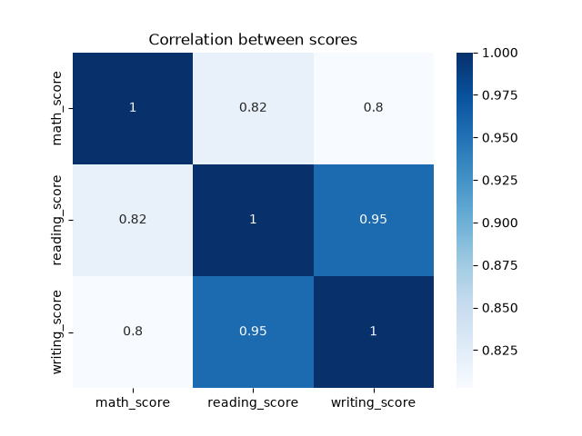
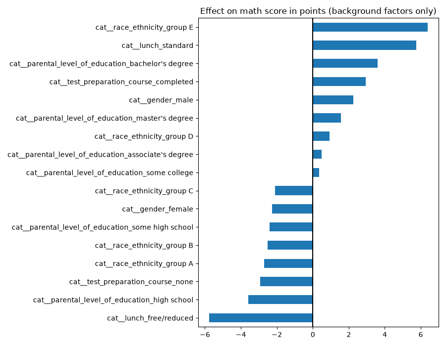
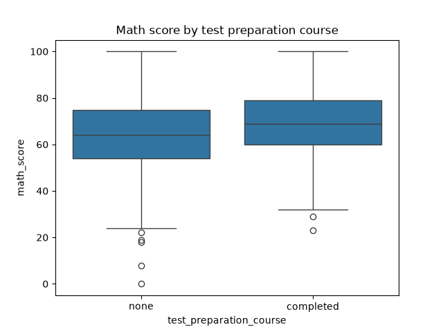

# Student Performance Predictor

A machine learning project that predicts students' **math scores** and explores which factors are linked to exam performance. Built with Python and scikit-learn as an end-to-end workflow (data checking, exploration, model comparison and evaluation), then deployed as an interactive web app with Streamlit.

**Live demo:** https://your-app-link.streamlit.app

## Problem

Can a student's math score be predicted from their background and their other exam scores, and which factors matter most?

I answered this with two experiments:

- **Experiment A:** background factors plus reading and writing scores
- **Experiment B:** background factors only (gender, ethnicity group, parental education, lunch type, test preparation course)

## Dataset

[Students Performance in Exams](https://www.kaggle.com/datasets/spscientist/students-performance-in-exams) (Kaggle): 1,000 students, 8 columns, no missing values and no duplicate rows.

| Column | Type |
|---|---|
| gender, race/ethnicity, parental level of education, lunch, test preparation course | Categorical |
| math score, reading score, writing score | Numeric (0-100) |

The dataset is not included in this repository. Download it from the link above.

## Method

1. **Checked the data** for missing values and duplicates, and reviewed summary statistics.
2. **Explored** score distributions and group differences with charts.
3. **Encoded** categorical columns with one-hot encoding inside a scikit-learn `Pipeline`.
4. **Split** the data 80/20 into training and test sets (`random_state=42`).
5. **Trained and compared** three models: Linear Regression, Decision Tree (max depth 5) and Random Forest (200 trees).
6. **Evaluated** with R², MAE, RMSE and 5-fold cross-validation.
7. **Interpreted** the Linear Regression coefficients to see how each factor relates to math score.
8. **Deployed** the best model (Linear Regression, Experiment A) as a Streamlit web app.

## Results

### Experiment A: background + reading and writing scores

| Model | R² | MAE | RMSE | CV R² (5-fold) |
|---|---|---|---|---|
| **Linear Regression** | **0.880** | **4.22** | **5.39** | **0.872** |
| Decision Tree | 0.824 | 4.93 | 6.54 | 0.793 |
| Random Forest | 0.853 | 4.63 | 5.98 | 0.836 |

### Experiment B: background factors only

| Model | R² | MAE | RMSE | CV R² (5-fold) |
|---|---|---|---|---|
| **Linear Regression** | **0.176** | **11.27** | **14.16** | **0.228** |
| Decision Tree | 0.091 | 11.58 | 14.87 | 0.109 |
| Random Forest | -0.018 | 12.38 | 15.74 | 0.011 |



### Key findings

- **A simple model was enough.** Linear Regression performed best in both experiments. With reading and writing scores it explains about 88% of the variation in math scores, with predictions off by about 4 points on average.
- **Reading and writing scores are the strongest predictors of math score.** Background factors alone explain much less (R² about 0.18).
- **The Random Forest overfits in Experiment B.** Its negative R² means it did slightly worse than predicting the average score, because the background features are weak and noisy.
- **Coefficients from the background-only model** (points added or removed from the predicted math score):

| Factor | Higher group | Lower group | Gap |
|---|---|---|---|
| Lunch type | standard (+5.76) | free/reduced (-5.76) | 11.5 points |
| Test preparation course | completed (+2.94) | none (-2.94) | 5.9 points |
| Gender | male (+2.26) | female (-2.26) | 4.5 points |
| Parental education | bachelor's degree (+3.61) | high school (-3.60) | 7.2 points |

- **A factor's effect depends on what else is in the model.** In the full model (Experiment A), the lunch gap shrinks to roughly 4 points, because reading and writing scores already capture part of that effect.





## Web app

`app.py` loads the trained Linear Regression model (`model_full.pkl`) and lets a user enter a student's details with dropdowns and sliders. The app then shows a predicted math score between 0 and 100. On test data the predictions were off by about 4 points on average.

## Limitations

- These are **associations, not causes**. For example, lunch type may reflect family income, but the data cannot show why the gap exists.
- Race/ethnicity is given as anonymous groups (A to E), so no conclusions are drawn about any group.
- The dataset is small (1,000 students) and has no study hours or attendance data, which would likely be useful predictors.
- This is a learning project. It should not be used to make real decisions about students.

## How to run

```bash
git clone https://github.com/vashika-0507/student-performance-predictor.git
cd student-performance-predictor
pip install -r requirements.txt
# download StudentsPerformance.csv from Kaggle and place it in this folder
python student_performance.py      # analysis, charts and model training
python -m streamlit run app.py     # web app at http://localhost:8501
```

The analysis script prints the results tables, saves charts to `charts/`, and saves two trained models (`model_full.pkl` and `model_background.pkl`). The web app only needs `model_full.pkl`.

## Project structure

```
student-performance-predictor/
├── student_performance.py   # full analysis and model training workflow
├── app.py                   # Streamlit web app
├── model_full.pkl           # trained model used by the app
├── requirements.txt
├── charts/                  # generated charts
└── README.md
```

## Technologies

Python, pandas, NumPy, scikit-learn, Matplotlib, Seaborn, joblib, Streamlit

## Author

**Vashika Maheswaran**, BSc (Hons) Artificial Intelligence with Data Science, Robert Gordon University (delivered by IIT, Colombo)
[GitHub](https://github.com/vashika-0507) · [LinkedIn](https://www.linkedin.com/in/vashika-maheswaran-71a17738b)
